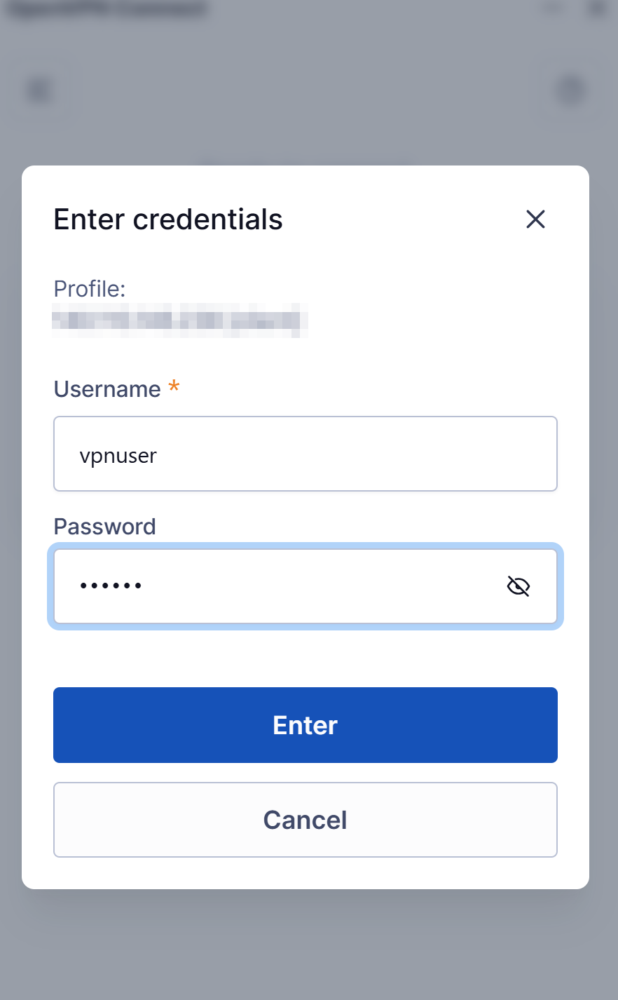
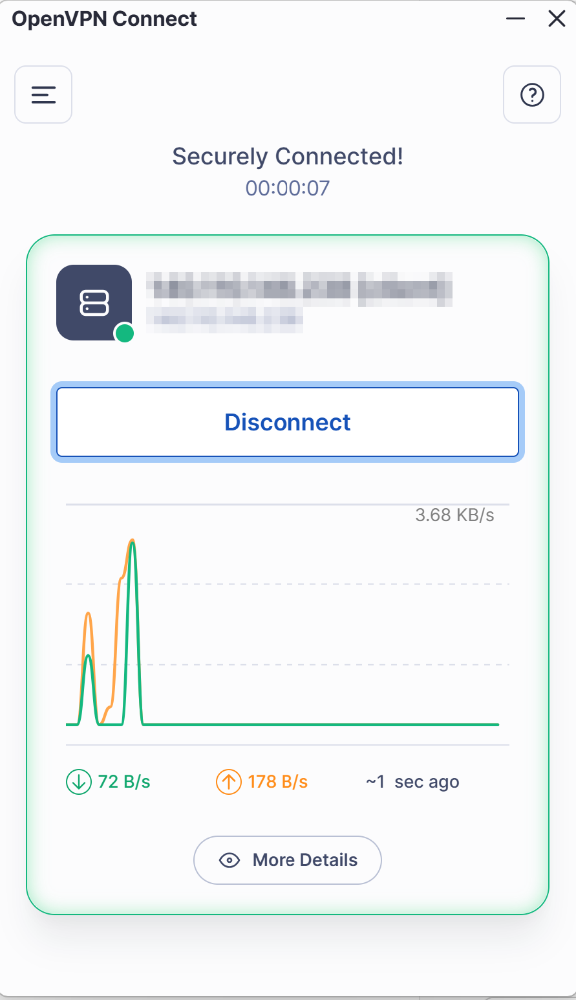

# 一、總覽

連線算力平台需要兩樣東西：

1. **電腦**：安裝 OpenVPN Connect，並匯入管理員提供的連線設定檔。
2. **手機**：安裝 Google Authenticator，用來產生每 30 秒更新一次的 6 位數動態密碼。

每次連線時，輸入「帳號」與「手機上當下的 6 位數動態密碼」即可。

| 階段 | 誰來做 | 頻率 |
|---|---|---|
| 準備帳號與設定檔 | 管理員 | 每位使用者一次 |
| 安裝軟體、匯入設定檔、綁定手機 | 使用者 | 第一次 |
| 輸入帳號與動態密碼連線 | 使用者 | 每次 |

# 二、管理員需提供給使用者的資料

| 項目 | 內容 | 交付方式 |
|---|---|---|
| 連線設定檔 | `client1.ovpn`（內含伺服器位址與用戶端憑證） | 以加密壓縮檔或院內安全管道傳送，**勿用公開雲端連結** |
| VPN 帳號 | 例如 `dr_chen` | 可一般通知 |
| 動態密碼 QR Code | 每人專屬，或提供「設定金鑰」文字 | **只交給本人**，建議當面掃描；不可轉寄、不可截圖留存 |
| 聯絡窗口 | 連線問題的聯絡人與電話 | 一般通知 |

伺服器位址：`<VPN_SERVER_IP>`，UDP 1194（已內含在設定檔中，使用者不需手動輸入）。

## 管理員準備步驟（伺服器端）

```bash
cd /home/ubuntu/openvpn_otp_guide/scripts

# 1. 建立帳號並產生 QR Code（每位使用者一次）
sudo bash add_user.sh dr_chen

# 2. 連線設定檔（全體共用一份即可；已存在就不用重做）
sudo bash make_client.sh client1 <VPN_SERVER_IP>

# 3. 交付後刪除 QR Code 圖檔
rm /home/ubuntu/openvpn_client/otp_dr_chen.png
```

檔案產出位置：`/home/ubuntu/openvpn_client/`

## 使用者離職或停用

```bash
sudo bash del_user.sh dr_chen
```

立即生效，其他人不受影響。

# 三、使用者需安裝的軟體

| 裝置 | 軟體 | 下載位置 |
|---|---|---|
| Windows／macOS 電腦 | **OpenVPN Connect** | https://openvpn.net/client/ |
| iPhone | **Google Authenticator** | App Store 搜尋「Google Authenticator」 |
| Android | **Google Authenticator** | Google Play 搜尋「Google Authenticator」 |

- 安裝 OpenVPN Connect 需要電腦的系統管理員權限。院內公務電腦若無法安裝，請洽院內資訊室。
- 手機也可以改用 Microsoft Authenticator，操作方式相同。

# 四、第一次設定

## 步驟 1：匯入連線設定檔（電腦）

1. 開啟 OpenVPN Connect。
2. 選「Upload File」，把管理員提供的 `.ovpn` 檔拖進視窗（或點 Browse 選擇檔案）。
3. 出現設定畫面時：
   - **Username** 可先填入你的帳號。
   - **不要勾選**「Save password」：動態密碼每 30 秒就會變，存起來沒有用。
4. 按「Connect」或「Add」完成匯入。

## 步驟 2：綁定動態密碼（手機）

1. 開啟 Google Authenticator，點右下角「＋」。
2. 選「掃描 QR 碼」，掃描管理員提供的 QR Code。
   - 無法掃描時，改選「輸入設定金鑰」：
     - 帳戶名稱：自訂，例如「算力平台 VPN」
     - 金鑰：管理員提供的一串英數字
     - 金鑰類型：**時間型**
3. 完成後，App 會出現一組每 30 秒更新的 6 位數字。

# 五、每次連線

1. 開啟 OpenVPN Connect，點選設定檔旁的開關（或「Connect」）。
2. 在「Enter credentials」視窗輸入：
   - **Username**：你的 VPN 帳號
   - **Password**：手機 Google Authenticator 上**當下**顯示的 6 位數字
3. 按「Enter」。

{width=45%}

4. 畫面顯示 **Securely Connected!**，且圖示變成綠色，即表示連線成功。

{width=45%}

## 中斷連線

點選「Disconnect」。使用完畢請中斷連線。

## 連線期間的注意事項

- 連線後，電腦的所有網路流量都會經由算力平台傳送。若影響院內其他系統使用，請先中斷 VPN。
- 閒置或網路中斷後，重新連線時需要再輸入一次新的動態密碼。

# 六、常見問題

| 狀況 | 可能原因 | 處理方式 |
|---|---|---|
| 顯示「Authentication failed」 | 動態密碼輸入錯誤或已過期 | 等手機出現**下一組**數字再輸入（同一組只能使用一次） |
| 連續失敗好幾次 | 觸發頻率限制（每 30 秒最多 3 次） | 等 1 分鐘後再試 |
| 動態密碼一直錯誤 | 手機時間不準 | 手機設定中開啟「自動設定日期與時間」 |
| 一直停在「Connecting」 | 院內防火牆擋住 UDP 1194 | 請院內資訊室開放對外連線至 `<VPN_SERVER_IP>` UDP 1194 |
| 換了新的設定檔仍連不上 | OpenVPN Connect 還在用舊的設定檔 | 刪除舊設定檔（垃圾桶圖示）後重新匯入 |
| 手機遺失或更換 | — | 立即通知管理員停用，由管理員重新產生 QR Code 後再綁定 |

# 七、資安守則

- `.ovpn` 設定檔內含數位憑證，請勿轉寄或上傳到公開位置。
- QR Code 與設定金鑰等同密碼，只能自己使用，不要截圖或分享。
- 帳號只限本人使用。所有連線都有紀錄，可追溯到個人。
- 手機遺失、人員異動時，請立即通知管理員。
